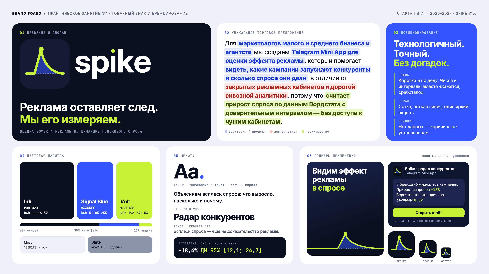

# Практическое занятие №1. Товарный знак и брендирование

**Дисциплина:** Стартап в информационных технологиях
**Институт:** Институт перспективных технологий и индустриального программирования
**Кафедра:** Кафедра индустриального программирования
**Преподаватель:** Адышкин Сергей Сергеевич
**Авторы:** Михалев Даниил, Баскаев Даниэль, Мельников Никита
**Стартап:** сервис оценки эффекта рекламы по динамике поискового спроса (Яндекс Вордстат), Telegram Mini App

> Итоговая визуальная часть: [brand_board.png](https://raw.githubusercontent.com/Mikkkaaa/spike/ebfa0b40945a9e2aac9bc87beb3bfe17a6ddf787/practice_1/brand_board.png) и [Spike_brand_board.pptx](https://github.com/Mikkkaaa/spike/blob/ebfa0b40945a9e2aac9bc87beb3bfe17a6ddf787/practice_1/Spike_brand_board.pptx) (один слайд). Логотипы: папка [shared/brand/logo/](https://github.com/Mikkkaaa/spike/tree/ebfa0b40945a9e2aac9bc87beb3bfe17a6ddf787/shared/brand/logo).

---

Идею сервиса, принцип оценки и план MVP описали в [концепции Spike](#концепция-spike).

## 1. Что мы сделали

Для Spike мы придумали название и слоган, нарисовали логотип, подобрали цвета и шрифты. На одном слайде собрали фирменный стиль и показали, как он будет выглядеть на обложке канала и в Telegram.

Spike задуман как Telegram Mini App для оценки эффекта рекламы по данным Вордстата. Мы хотим показывать прирост поискового спроса с доверительным интервалом и отмечать другие возможные причины всплеска, например сезонность или новости.

**Аудитория:** маркетологи малого и среднего бизнеса и агентства.
**Главная ценность:** честная оценка «сколько дала реклама» и «какая реклама у конкурентов», с вероятностью и интервалом, а не «кажется, сработало».

В основу логотипа мы взяли график поисковых запросов с заметным пиком.

---

## 2. Бренд, товарный знак, логотип (как это применено)

| Понятие | Что это | Как у нас |
|---|---|---|
| **Бренд** | Совокупность ассоциаций и ожиданий | «Спокойная точность»: цифры, интервалы, честное «причина не установлена» |
| **Товарный знак** | Юридически защищённое обозначение (Роспатент) | Планируется комбинированное обозначение (знак + слово). На MVP не обязательно, см. раздел 8 |
| **Логотип** | Графический символ бренда | Знак «всплеск над пунктирной базовой линией» + слово `spike` |

---

## 3. Наименование: **Spike** (Спайк)

**Почему именно так**

- *Spike* (англ.) = резкий всплеск. Ровно то, что ищет детектор: всплеск поискового спроса, похожий на рекламную кампанию.
- Один слог на каждую половину, читается одинаково на латинице и кириллице: *Spike / Спайк*.
- Короткое, «продуктовое» название в стиле современных SaaS (по длине и ритму как Linear, Notion, Slack).
- Легко произнести в Telegram-чатах маркетологов и в названии бота.

**Запасные варианты** (если Spike окажется занят или не понравится): *Liftwave*, *Baseline*, *Вспышка*, *Spikely*. Название легко заменить: логотип собирается скриптом, а вордмарк построен из контуров шрифта.

**Важная оговорка.** Слово *spike* очень распространённое. Мы не проверяли занятость названия в базе ФИПС (Роспатент), занятость домена и никнейма в Telegram. Для практики это не критично, но до реальной регистрации знака проверку нужно сделать (раздел 8).

---

## 4. Слоган

> **Реклама оставляет след. Мы его измеряем.**

Первая фраза про проблему (след рекламы виден в спросе), вторая про наше действие и тон бренда: «измеряем», а не «угадываем». Слоган передаёт УТП в двух коротких предложениях.

Описатель (под логотипом, мелким шрифтом): *Оценка эффекта рекламы по динамике поискового спроса*.

---

## 5. УТП

### По шаблону из задания

> Для **маркетологов малого и среднего бизнеса и агентств** мы создаём **Telegram Mini App для оценки эффекта рекламы**, который помогает **видеть, какие кампании запускают конкуренты и сколько спроса они дали**, в отличие от **закрытых рекламных кабинетов и дорогой сквозной аналитики**, потому что **считает прирост спроса по данным Вордстата с доверительным интервалом, без доступа к чужим кабинетам**.

### Короткая версия (для питча в одну строку)

> Spike показывает, какая реклама у конкурентов сработала и на сколько, не заглядывая в их кабинеты.

### Почему это не «у нас лучше»

УТП измеримо и конкретно:

1. **Конкретная аудитория:** маркетологи МСБ и агентства.
2. **Конкретный результат:** прирост запросов с доверительным интервалом и вероятностью, что причина именно реклама.
3. **Конкретное отличие:** не нужен доступ к кабинету, а у конкурентов его и не будет.

### Сравнение с альтернативами

| Альтернатива | Что делает | Чем Spike отличается |
|---|---|---|
| **Brand Lift Яндекса / VK Рекламы** | Опрос тестовой и контрольной групп внутри кампании, которую вы купили у платформы ([блог Click.ru](https://blog.click.ru/management/brand-lift-ot-google-i-yandeksa/)) | Работает только для своих кампаний на этой площадке. Spike видит и чужие кампании, и любые каналы, если они влияют на поиск |
| **Сквозная аналитика** (Calltouch, Roistat и др.) | Связывает расходы на рекламу, звонки, заявки и продажи. По открытым обзорам цены стартуют примерно с 5–6 тыс. ₽/мес, сильно зависят от тарифа ([обзор Workspace](https://workspace.ru/blog/obzor-luchshikh-servisov-skvoznoy-analitiki/)) | Нужен доступ к своим данным и настроенная интеграция. Про конкурентов ничего не расскажет |
| **Мониторинг рекламы** (например, Robuscan) | Следит за объявлениями по брендовым запросам в выдаче, скриншоты, ссылки, редиректы ([каталог CRMindex](https://crmindex.ru/services/robuscan)) | Другая задача: видит сами объявления, но не оценивает, сколько спроса они принесли |
| **Ручной просмотр Вордстата** | Сравнение графиков глазами | Сезонность, инфоповоды и рынок искажают картину. Spike вычитает прогноз «без кампании» и показывает интервал |

### Как выглядят сайты конкурентов

Мы сравнили первые экраны двух сервисов, которые помогают маркетологам оценивать рекламу.

- У Roistat белый фон, синие кнопки и карточки с графиками, прибылью и расходами. Заголовок говорит о прибыли от рекламы, а изображение рядом показывает, какие отчёты получит пользователь. [Сайт Roistat](https://roistat.com/ru/)
- У Calltouch тёмный фон, крупный белый заголовок, жёлтая кнопка и цветные значки вокруг логотипа. В тексте компания говорит о привлечении клиентов, конверсии и аналитике. Первый экран показывает, что эти задачи объединены в одном сервисе. [Сайт Calltouch](https://www.calltouch.ru/)

У Spike задача уже: показать, как изменился поисковый спрос после кампании. Поэтому мы вынесли в знак один всплеск, а пунктиром обозначили прогноз спроса без кампании. В примере отчёта рядом с числом показываем интервал.

---

## 6. Позиционирование

**Кто мы:** аналитический инструмент для людей, которым нужно принять решение по рекламе.
**Для кого:** маркетологи МСБ, агентства.
**В чём уникальность:** причинная оценка эффекта по поисковому спросу, видно кампании конкурентов.

**Характер бренда: технологичный, точный, без догадок.**

| Ось | Решение |
|---|---|
| **Голос** | Коротко и по делу. Числа и интервалы вместо «кажется, сработало». Пример: «Прирост +18% (ДИ 95%: +12…+24%), вероятность рекламы 0,82» |
| **Образ** | Сетка, чёткая линия, один яркий акцент |
| **Принцип** | Честность: если данных мало, сервис пишет «причина не установлена» (это правило агента-аналитика из описания продукта) |
| **Чего избегаем** | «Магии» и обещаний «рост x10», мультяшной подачи, градиентной перегрузки |

---

## 7. Визуальная айдентика

### 7.1. Цвета (3 фирменных + 2 нейтральных)

| Роль | Название | HEX | RGB | Смысл |
|---|---|---|---|---|
| Основа (≈60%) | **Ink** | `#0B1020` | 11 · 16 · 32 | Серьёзность, «ночной экран аналитика» |
| Интерфейс (≈30%) | **Signal Blue** | `#3355FF` | 51 · 85 · 255 | Технологичность, доверие, кнопки и ссылки |
| Акцент (≈10%) | **Volt** | `#C6F135` | 198 · 241 · 53 | Сам «всплеск»: линия роста, оповещение, главная кнопка |
| Нейтральный фон | Mist | `#EEF1F8` | 238 · 241 · 248 | Светлый фон |
| Нейтральный текст | Slate | `#8A93A8` | 138 · 147 · 168 | Подписи, пунктир базовой линии |

**Проверка читаемости (контраст по WCAG, рассчитан):**

| Пара | Контраст | Вывод |
|---|---|---|
| Ink на белом | 18,9 : 1 | основной текст |
| Volt на Ink | 14,5 : 1 | акцент на тёмном, отлично |
| Signal Blue на белом | 5,4 : 1 | годится для текста и кнопок |
| Белый на Signal Blue | 5,4 : 1 | годится |
| Signal Blue на Ink | 3,5 : 1 | только для крупных элементов, не для мелкого текста |
| **Volt на белом** | **1,3 : 1** | **нельзя**: Volt только на тёмном фоне |

Правило: Volt используется только на Ink или Signal Blue. На светлом фоне акцентом служит Signal Blue.

### 7.2. Шрифты (2)

| Шрифт | Где | Почему |
|---|---|---|
| **Inter** (Bold, SemiBold, Medium, Regular) | Заголовки, текст, интерфейс | Нейтральный, отлично читается в мелких размерах, есть латиница и кириллица |
| **JetBrains Mono** | Числа, интервалы, метки, код | «Табличные» цифры: числа выравниваются и выглядят как показания прибора. Латиница и кириллица есть |

Оба шрифта бесплатные (лицензия OFL), файлы лежат в [shared/brand/fonts/](https://github.com/Mikkkaaa/spike/tree/ebfa0b40945a9e2aac9bc87beb3bfe17a6ddf787/shared/brand/fonts).

### 7.3. Логотип

**Знак.** Квадрат с закруглёнными углами (форма иконки приложения / Mini App). Внутри график спроса:

- **пунктирная линия** внизу: прогноз спроса «без кампании» (базовая линия модели);
- **сплошная линия Volt**: фактический спрос, резко уходит вверх и затухает;
- **синяя заливка** между ними: тот самый прирост, который мы измеряем;
- **точка на вершине**: пойманный всплеск, то, о чём приходит оповещение.

Знак буквально рисует то, что делает продукт: «было бы вот так, а стало вот так, разница наша».

**Вордмарк.** `spike`, строчными, Inter Display Bold; буквы переведены в контуры, шрифт для показа не нужен. Точка над «i» синяя (на тёмном фоне Volt): повтор точки-вершины на знаке.

**Файлы логотипа (папка [shared/brand/logo/](https://github.com/Mikkkaaa/spike/tree/ebfa0b40945a9e2aac9bc87beb3bfe17a6ddf787/shared/brand/logo)):**

| Файл | Где использовать |
|---|---|
| `spike-icon.svg / .png` | Иконка приложения, аватар бота и канала |
| `spike-logo-horizontal.svg / .png` | Знак + слово для светлого фона (документы, сайт, презентации) |
| `spike-logo-horizontal-dark-bg.svg / .png` | То же для тёмного фона |
| `spike-mark-light-bg.svg / .png` | Только график, без плашки, для светлого фона |
| `spike-mark-dark-bg.svg / .png` | Только график, без плашки, для тёмного фона |

PNG: 1024 px (знак) и 2716×1024 (горизонтальный логотип), фон прозрачный.

**Правила использования:**

- Охранное поле: не менее ширины заглавной точки знака (≈ 1/8 высоты иконки) со всех сторон.
- Минимальный размер: иконка 24 px, горизонтальный логотип 96 px по ширине.
- Не растягивать, не менять цвета, не размещать Volt на светлом фоне, не добавлять тени и обводку.
- Читаемость в малом размере проверена на иконках 104, 68 и 40 px (см. brand board).

**Инструмент.** Логотип собрали с помощью Python и SVG. Векторный знак можно использовать на слайде, сайте и в иконке приложения.

---

## 8. Товарный знак (Роспатент)

**Что регистрировать.** Комбинированное обозначение (знак + слово `spike`). Регистрация словесного обозначения даёт защиту названия независимо от начертания, графического знака защиту рисунка. Комбинированное покрывает оба элемента, но слабее защищает «просто слово» в другом начертании.

**Предполагаемые классы МКТУ** (требуют проверки с патентным поверенным или по классификатору):

- 9: программное обеспечение (приложения);
- 35: реклама, исследования рынка;
- 42: услуги ПО / SaaS, анализ данных.

**Статус на MVP.** Регистрация не обязательна, но важны риски:

1. **Занятость названия.** *Spike* слишком общее слово. В классах ПО и рекламы вероятны схожие обозначения других правообладателей. До регистрации и до публичного запуска надо проверить базу ФИПС (поиск по сходству) и выбрать запасное название при необходимости. Мы пока не проверяли базу.
2. **Чужие элементы.** Логотип создан с нуля, чужие картинки и иконки не использовались. Шрифты лицензированы (OFL), коммерческое использование разрешено.
3. **Слоган и описатель** отдельно регистрировать не нужно.

---

## 9. Связь визуального образа с идеей стартапа

| Элемент | Идея продукта |
|---|---|
| Пунктир | Модель строит прогноз «без кампании» |
| Сплошная линия, пик | Фактический спрос, всплеск, похожий на кампанию |
| Синяя область | Прирост, который сервис оценивает, и вокруг него доверительный интервал |
| Тёмная тема + моноширинные цифры | Аналитика, точность, показания прибора |
| Volt-акцент | Оповещение «у бренда X началась кампания» |
| Квадрат с радиусом | Иконка Telegram Mini App |

---

## 10. Примеры применения (на brand board)

1. **Баннер / обложка канала:** «Видим эффект рекламы в спросе».
2. **Оповещение в Telegram Mini App:** «У бренда Х началась кампания. Прирост запросов +18%. Вероятность, что причина реклама: 0,82. Есть альтернативы: инфоповод, сезон». *В макете использованы условные числа.*
3. **Иконки приложения** трёх размеров.

---

## 11. Текст защиты (2–3 минуты, ≈ 330 слов)

**[Название и слоган, 25 с]**
Наш стартап называется **Spike**. Слоган: «Реклама оставляет след. Мы его измеряем». Spike оценивает, насколько рекламные кампании, в том числе конкурентов, увеличили поисковый спрос на бренд. Всё по открытым данным Яндекс Вордстата, без доступа к рекламным кабинетам.

**[Проблема и УТП, 40 с]**
Сейчас маркетолог смотрит на график брендовых запросов вручную и не может понять: это реклама, инфоповод или просто сезон? Кабинеты конкурентов закрыты, сквозная аналитика стоит от пяти тысяч рублей в месяц и показывает только свои данные, а Brand Lift Яндекса работает только для купленных у них кампаний. Наше УТП: для маркетологов малого и среднего бизнеса и агентств мы создаём Telegram Mini App, который помогает видеть, какие кампании запускают конкуренты и сколько спроса они дали, в отличие от закрытых кабинетов и дорогой сквозной аналитики, потому что считает прирост спроса по данным Вордстата с доверительным интервалом.

**[Логотип и связь с идеей, 45 с]**
Логотип рисует работу нашей модели. Пунктир это прогноз спроса «без кампании». Сплошная линия это реальный спрос: он резко вырос и затух. Заливка между ними это прирост, который мы измеряем. Точка на вершине это пойманный всплеск, а такую же точку вы видите над буквой «i» в названии. Знак вписан в квадрат с радиусом, как иконка Mini App.

**[Цвета и шрифты, 35 с]**
Палитра из трёх цветов. Ink, тёмно-синий, основа: серьёзность и аналитика. Signal Blue, интерфейс и доверие. Volt, кислотно-салатовый, акцент: это всплеск и оповещение, использовали только на тёмном фоне, иначе плохо читается. Два шрифта: Inter для текста и JetBrains Mono для цифр, потому что у нас в продукте главное числа и интервалы.

**[Позиционирование и итог, 30 с]**
Бренд технологичный и точный. Мы не говорим «реклама сработала», мы говорим «плюс 18% с доверительным интервалом, вероятность 0,82». А если данных мало, прямо пишем «причина не установлена». Spike: реклама оставляет след, мы его измеряем.

---

## 12. Соответствие «Ожидаемым результатам» из задания

| Требование | Выполнено |
|---|---|
| Сформулированный бренд (название, УТП, слоган) | разделы 3–5 |
| Подобран визуальный стиль (2–3 цвета, 1–2 шрифта, позиционирование) | разделы 6–7 |
| Прототип логотипа | раздел 7.3, папка `shared/brand/logo/` |
| Brand board на одном слайде/листе | [Spike_brand_board.pptx](https://github.com/Mikkkaaa/spike/blob/ebfa0b40945a9e2aac9bc87beb3bfe17a6ddf787/practice_1/Spike_brand_board.pptx), [brand_board.png](https://raw.githubusercontent.com/Mikkkaaa/spike/ebfa0b40945a9e2aac9bc87beb3bfe17a6ddf787/practice_1/brand_board.png) |
| Название и слоган, УТП, логотип, палитра, примеры применения на board | все блоки на board |
| Задание «посмотрите, как позиционируют себя конкуренты» | раздел 5, сравнение функций, оформления и текста первых экранов |
| Короткая презентация 2–3 минуты | раздел 11 |

---

## 13. Допущения и что стоит проверить

- Занятость названия в ФИПС, домене и Telegram пока не проверяли.
- Цифры в макете оповещения (+18%, 0,82) условные.
- Слайд PPTX содержит brand board как изображение высокого разрешения (не редактируется как набор объектов); исходник для правок: `brand_board.html`.
- Данные о конкурентах взяты из открытых обзоров; точные тарифы и условия нужно сверить на сайтах производителей.

## Концепция Spike

Маркетологу трудно определить, связан ли рост запросов о бренде с рекламой. На поисковый спрос также влияют сезонность, новости, акции и конкуренты. Данные из рекламных кабинетов других компаний обычно недоступны. Мы предложили оценивать изменение спроса по рядам Яндекс Вордстата.

### Как должен работать сервис

1. Собираем ряды брендовых запросов и данные для сравнения по конкурентам и категории. Если условия API позволяют, сохраняем региональные срезы, чтобы собрать историю.
2. Строим прогноз спроса без кампании с учётом фоновой динамики и сезонности.
3. Находим отклонения от прогноза. Сверяем их с датами известных кампаний и проверяем другие объяснения всплеска.
4. Показываем график, оценку прироста, доверительный интервал и возможные причины. Если данных мало, пишем «Причина не установлена».

Мы задумали две функции в Telegram Mini App. Радар предупреждает об изменении спроса на отслеживаемый бренд, а отчёт показывает динамику вокруг дат собственной кампании. Когда проверим базовую оценку, сможем добавить агента для объяснений и еженедельного дайджеста. Числа для ответа он будет брать из отчёта, а объяснения сопровождать ссылками на источники.

### План проверки на десять недель

| Срок | Что планируем сделать |
| --- | --- |
| Неделя 1 | Запросить доступ к API и начать собирать данные по 8–10 брендам одной категории |
| Недели 2–4 | Собрать базовую модель и проверить её на 15–20 кампаниях с известными датами |
| Недели 5–6 | Сделать первую версию радара и отчёта |
| Недели 7–10 | Показать продукт 8–10 маркетологам и агентствам, собрать обратную связь |

Качество оценки проверим по доле найденных кампаний, ложным срабатываниям и покрытию интервалов. В пилоте посмотрим, какие оповещения оказались полезными, кто возвращается за вторым отчётом и кто готов платить. Числа в плане являются целями пилота.

Главные ограничения связаны с условиями доступа к данным, шумом на редких запросах и охватом поиска Яндекса. Если доступа к API окажется недостаточно, проверим, можно ли использовать ручные выгрузки для небольшого набора запросов.

Подготовили бренд, [лендинг](../practice03/) и [питч для инвестора](../practice07/). Дополнительные детали есть в [исходном предложении от 20 октября 2026 года](https://github.com/Mikkkaaa/spike/blob/ebfa0b40945a9e2aac9bc87beb3bfe17a6ddf787/practice_1/startup_topic_proposal.pdf).
